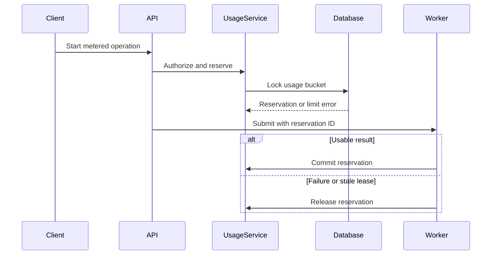

# Central Entitlements and Usage Service

## Product rules
- Seed Explorer, Essential, Professional, and Power as versioned plans; admins assign subscriptions and grant PAYG/promotional credits manually.
- Meter `fit_check`, `application_pack`, and `section_regeneration`; treat `career_documents`, `storage_bytes`, and `concurrent_workflows` as current-state limits.
- A basic analysis consumes one Fit Check. Research or first document generation consumes one Application Pack and creates a per-job unlock covering research, strategy, initial CV, and initial cover letter. Repeated unchanged requests reuse that unlock; section regeneration remains separately metered.
- Reserve allowance before work begins, commit only when a usable result succeeds, and release on application/provider/worker failure. Use idempotency keys based on user, operation, resource, and normalized-input revision.
- Never gate evidence validation, privacy, editing, account export/deletion, or bilingual support.

## Architecture and persistence
- Add `[backend/app/models/entitlements.py](backend/app/models/entitlements.py)` with `Plan`, immutable `PlanVersion`, admin-assigned `Subscription`, expiring `CreditGrant`, temporary `EntitlementOverride`, period `UsageBucket`, append-only `UsageEvent`, `UsageReservation`, and `ApplicationPackUnlock` models. Add uniqueness constraints for plan codes/versions, one active subscription per user, idempotent reservations, and one pack unlock per job revision.
- Export models through `[backend/app/models/__init__.py](backend/app/models/__init__.py)` and create `[backend/alembic/versions/0008_entitlements_usage.py](backend/alembic/versions/0008_entitlements_usage.py)`, explicitly chained after the existing untracked `0007_professional_knowledge` migration. Backfill existing users onto Explorer without changing their workspace data.
- Add typed request/response contracts in `[backend/app/schemas/entitlements.py](backend/app/schemas/entitlements.py)` and stable meter/feature keys in a small entitlement constants module.
- Implement `[backend/app/services/entitlements.py](backend/app/services/entitlements.py)` to resolve the effective plan version, subscription status, feature flags, temporary overrides, template access, limits, and reset dates.
- Implement `[backend/app/services/usage.py](backend/app/services/usage.py)` for summaries, PostgreSQL `SELECT FOR UPDATE` reservation/commit/release, SQLite-compatible behavior, credit consumption by earliest expiry, storage checks, global per-user concurrency, stale-reservation cleanup, and structured `403/409` errors. Keep commercial limits below existing platform safety ceilings.

## Enforcement and observability
- Gate job analysis in `[backend/app/api/jobs.py](backend/app/api/jobs.py)`: basic analysis reserves a Fit Check; research obtains/reuses an Application Pack unlock; associate the reservation with `WorkflowRun`, then commit/release in every terminal and stale-run path.
- Gate strategy and all generation entry points in `[backend/app/api/applications.py](backend/app/api/applications.py)`: reuse the job’s pack unlock, prevent duplicate active generation globally per user, and release reservations through the existing failure handlers.
- Gate AI section regeneration in `[backend/app/api/documents.py](backend/app/api/documents.py)` with a synchronous reserve/commit/release transaction; feature-gate template and DOCX choices without metering repeated downloads.
- Enforce document count and storage before persistence in `[backend/app/api/career.py](backend/app/api/career.py)` and `[backend/app/services/ingestion.py](backend/app/services/ingestion.py)` while retaining the global 15 MB upload ceiling.
- Add `usage_reservation_id` to `WorkflowRun`, and direct `user_id`/reservation linkage to `AgentExecution` in `[backend/app/models/agent.py](backend/app/models/agent.py)`. Update `[backend/app/agents/base.py](backend/app/agents/base.py)` so token usage, retries, duration, and model are retained for successful and failed calls; these remain operational metrics, not customer-visible token billing.
- Assign the default plan during email, Google, and admin-created user provisioning in `[backend/app/api/auth.py](backend/app/api/auth.py)` and `[backend/app/api/admin.py](backend/app/api/admin.py)`. Make enforcement fail closed if a subscription cannot be resolved.

## APIs and administration
- Add user APIs in `[backend/app/api/entitlements.py](backend/app/api/entitlements.py)`: effective plan/features, current period usage (`included`, `consumed`, `reserved`, `remaining`), credits/expiry, pack-unlock state, and warning levels.
- Add `[backend/app/api/admin_entitlements.py](backend/app/api/admin_entitlements.py)` for plan metadata, draft/version/publish/archive operations, subscription assignment/status/period changes, expiring credits and overrides, per-user ledgers, fleet usage summaries, near-limit users, active/stale reservations, and top consumers. Published versions are read-only; all mutations use the existing audit service.
- Register routers in `[backend/app/main.py](backend/app/main.py)`, extend admin user summaries with plan/status/usage, and document contracts/error codes in `[docs/API.md](docs/API.md)` and the architecture in `[docs/ARCHITECTURE.md](docs/ARCHITECTURE.md)`.
- Use structured errors such as `FEATURE_NOT_AVAILABLE`, `SUBSCRIPTION_INACTIVE`, `USAGE_LIMIT_REACHED`, `CONCURRENT_WORKFLOW_LIMIT`, and `STORAGE_LIMIT_REACHED`, including limit, consumed, reserved, remaining, and reset date.

## Frontend management and usage UX
- Add entitlement types and shared structured-error parsing in `[frontend/src/api/types.ts](frontend/src/api/types.ts)` and `[frontend/src/lib/usageErrors.ts](frontend/src/lib/usageErrors.ts)`.
- Add reusable accessible usage cards/limit panels, then create `[frontend/src/pages/Usage.tsx](frontend/src/pages/Usage.tsx)` showing plan status, period, meters, reservations, credits, expiry, features, and 70/90/100% warnings; provider-free calls to action direct users to their administrator.
- Create `[frontend/src/pages/AdminPlans.tsx](frontend/src/pages/AdminPlans.tsx)` and `[frontend/src/pages/AdminPlanEditor.tsx](frontend/src/pages/AdminPlanEditor.tsx)` for draft creation, feature/limit/template configuration, immutable version history, preview, publish, and archive.
- Create `[frontend/src/pages/AdminUserEntitlements.tsx](frontend/src/pages/AdminUserEntitlements.tsx)` for plan assignment, periods/status, expiring overrides, credit grants, and usage/ledger history; extend `[frontend/src/pages/AdminUsers.tsx](frontend/src/pages/AdminUsers.tsx)` with plan and consumption summaries.
- Create `[frontend/src/pages/AdminUsageDashboard.tsx](frontend/src/pages/AdminUsageDashboard.tsx)` for plan distribution, usage by meter, near/exhausted users, concurrent/stale work, token totals by model, and drill-down. Register protected/user routes and navigation in `[frontend/src/App.tsx](frontend/src/App.tsx)` and `[frontend/src/components/ui.tsx](frontend/src/components/ui.tsx)`.
- Handle entitlement errors at all action surfaces (`JobDetail`, `Applications`, `ApplicationDetail`, `DocumentEditor`, `CareerKnowledge`, and `Onboarding`) with the shared limit panel while preserving the distinct advisory `BELOW_THRESHOLD` flow. Add matching English/Arabic strings and verify RTL behavior.

## Verification
- Add backend service/API/enforcement tests for plan immutability, default assignment, overrides, period boundaries, credit expiry/order, reservation idempotency, commit/release, pack reuse, unchanged-request retries, failed/stale workflows, storage, subscription inactivity, and admin authorization.
- Add a PostgreSQL-targeted concurrency test proving simultaneous requests cannot overspend the final unit; retain SQLite tests for normal service and API behavior. Validate migration on both a fresh PostgreSQL database and an existing database containing migration `0007`.
- Exercise an end-to-end scenario: Explorer exhausts a meter, receives a structured block, admin grants credit or changes the plan, the operation succeeds, and monitoring/user dashboards reflect reserved then consumed usage.
- Run backend tests and lint checks, frontend production build, and manual English/Arabic checks for plan publishing, user assignment, usage warnings, limit errors, workflow failure release, and downgrade behavior without data deletion.